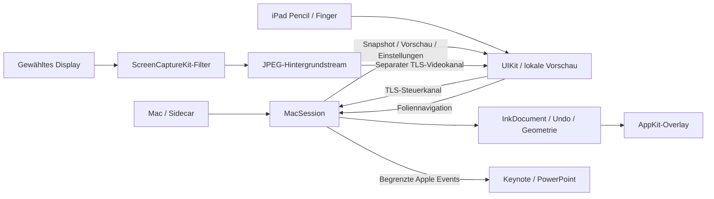

# Architekturentscheidungen – PresentInk 0.9.2

## Komponenten

AppKit stellt das transparente Mac-Overlay und den nicht aktivierenden Drawer bereit. SwiftUI verwaltet Einstellungen, Hilfe und Aboutbox. Die iPad-App verwendet SwiftUI mit einer UIKit-Zeichenfläche und nativen Texteditoren. `PresentInkCore` enthält Dokument, Stile, Geometrie, Textlayout und Automation-Typen. `PresentInkLink` enthält Nachrichten, Framing, TLS-Verbindung und Vorschauzustände. Beide Apps verwenden `SharedUI/InkRenderer.swift`.

## Verbindlicher Zustand

Der Mac ist die maßgebliche Instanz für `InkDocument` und Zeichenparameter. Punkte verwenden normalisierte Koordinaten mit Ursprung oben links; Breiten beziehen sich auf die kürzere Displaykante. Formfixierung und Manipulationen rechnen im logischen Displayraum, damit Seitenverhältnisse auch auf nicht quadratischen Displays stimmen. Rechteck/Ellipse können einen optionalen Drehwinkel tragen. Darstellung, Trefferprüfung und Radierer berücksichtigen ihn.

Eine neue Quelle oder geänderte Displaygeometrie erzeugt eine neue `epoch`; alte Befehle werden abgewiesen. Automatische Geometrieänderungen erhalten normalisierte Annotationen und Undo-Historie. Ein expliziter Quellenwechsel mit Löschwunsch ist gesondert bestätigt. Revisionen ordnen Snapshots; Command-IDs werden gegen doppelte Anwendung geprüft.

Ein aktiver Strich oder Transformationsentwurf hat genau einen Besitzer (`mac`/`ipad`). `previewTransform` bezieht sich auf das unveränderte Original und erlaubt ausschließlich Geometrieänderungen mit gleicher Identität, Punktzahl, Text und Stil. `commitTransform` legt genau einen Undo-Schritt an. Veraltete Originale, fremde Besitzer und übergroße/ungültige Daten werden abgewiesen. Abbruch und Verbindungsverlust verwerfen nur den Entwurf. Die Z-Reihenfolge bestätigter Objekte bleibt erhalten.

Undo/Redo gilt gemeinsam für das Dokument. Es gibt keine dauerhafte Speicherung von Zeichensitzungen. Die Notfallaktion kann den aktiven Entwurf abbrechen und das Overlay auf App-Ebene ausblenden.

## Eingabe, direkte Bearbeitung und Text

Freihand verwendet zusammengefasste UIKit-Samples und normalisierten Pencil-Druck. Das iPad zeichnet einen Entwurf lokal, bevor eine Netzwerkbestätigung eintrifft. Bestätigte lokale Änderungen bleiben ausstehend sichtbar, bis der Mac sie zurücksendet. Vorschau-Objekte ersetzen dasselbe Objekt anhand seiner UUID und werden nicht zusätzlich darüber gezeichnet.

`InkManipulation` bestimmt unsichtbare Trefferzonen: Mitte/Inneres verschiebt, Endpunkte drehen/strecken, Begrenzungsecken drehen Rechteck/Ellipse, Seitenmitten skalieren. Shift bzw. iPad-Raster erhält beim Skalieren das Seitenverhältnis und bindet Winkel an 45 Grad. Neue Formen werden damit zu Quadrat/Kreis. Am Mac umgeht Option die Objekttreffer, um darüber neu zu zeichnen. Der Standardcursor ist ein Pfeil; Bearbeitungscursor liefern Hinweise, ohne dauerhafte Auswahlrahmen.

Pencil und Finger sind verfügbar, jeweils mit einem aktiven Vorgang. Pencil verdrängt einen unbestätigten Fingerentwurf. Ein Kontaktgrößenfilter und eine kurze Finger-Sperre bei Pencil-Kontakt/Hover reduzieren Handballen-Eingaben. Vorhersagen und nachträgliche Korrekturen geschätzter Druckwerte werden nicht verarbeitet.

Inline-Text verwendet `NSTextView`/`UITextView`, um Eingabemethoden, native Auswahl und Scribble zu erhalten. Entwürfe bleiben lokal, bis sie bestätigt werden. Bestehender Text wird mit Originalvergleich ersetzt. Native Text-Undo-Vorgänge bleiben während des Schreibens im Editor; nach Bestätigung greift Dokument-Undo. Auf dem iPad ersetzen feste Done/Cancel-Buttons die normale Kopfzeile, während der Drawer ausgeblendet ist. Keyboard-Safe-Area-Änderungen skalieren die Zeichenfläche nicht um.

## Lokale Verbindung und Wire-Protokoll 9

- Bonjour `_presentink._tcp` und Network.framework; getrennte Steuer-/Videokanäle.
- Zufälliger, dauerhaft im Schlüsselbund gespeicherter Kopplungsschlüssel. Der iPad-Schlüssel wird erst nach authentifizierter Verbindung gespeichert.
- Domänenspezifischer SHA-256-PSK; TLS 1.2 PSK mit AES-128-GCM-SHA256 (`0x00A8`). Diese Suite bietet keine Forward Secrecy; eine modernisierte Kopplung bleibt ein zukünftiger Härtungsschritt.
- Ein Steuerclient und zugehöriger Videokanal mit derselben Client-ID. Verbindungen, Handshakes, Puffer und Nachrichtengrößen sind begrenzt.
- Vier Byte Netzwerklänge, danach JSON-`WireMessage`, maximal acht MiB. Der Decoder behandelt fragmentierte/zusammengefasste TCP-Lieferungen.
- `hello(version, client, channel)` muss die aktuelle Protokollversion verwenden. Beide Apps werden gemeinsam aktualisiert; gespeicherte Schlüssel bleiben verwendbar.
- Ersetzbare Vorschauen bis 30 Hz; Dokument-Snapshots werden gebündelt. Commit-/Steuerbefehle bleiben zuverlässig geordnet. Die separate `sourceEpoch` und Sequenz schützen Videobilder vor veralteten Aufnahmequellen; Vorschau-Status besitzt eine eigene monotone Revision.
- Ping/Pong misst Netzwerk-Roundtrip, keine Pencil-bis-Display-Latenz.

Einstellungen/Profile werden vom Mac verteilt und durch das iPad bestätigt. `navigateSlide(direction, request)` ist ein eigener authentifizierter Steuerbefehl. Navigationsfehler verändern die Zeichnung nicht; eine neue Epoch nach Erfolg verwirft alte Zeichenpakete. Während AppleScript auf die externe App wartet, wird kein mutierender Zugriff auf InkDocument gehalten, da eine Freigabenachfrage die Runloop erneut betreten kann.

## Foliensteuerung und Sandbox

Die zuletzt im Vordergrund beobachtete unterstützte App ist das Ziel. Läuft nur eine unterstützte App, ist sie auch ohne beobachteten Fokus eindeutig. Bei mehreren möglichen Zielen wird eine Fehlermeldung angezeigt, bis der Nutzer die gewünschte App am Mac aktiviert.

Native AppleScript-Befehle steuern Keynote und PowerPoint. Die App-Sandbox bleibt aktiv; Apple-Event-Ausnahmen sind auf deren Bundle-IDs begrenzt. `NSAppleEventsUsageDescription` erklärt die Funktion, die Automation-Freigabe erteilt der Nutzer über macOS. Keine allgemeinen Tastaturereignisse und keine System-Events-Steuerung. Keynote kann zum nächsten Build/Slide weiterschalten, PowerPoint verwendet die Slideshow-Befehle für nächste/vorherige Folie. Nach erfolgreichem PresentInk-Befehl wird das Dokument rückgängig machbar geleert und die Epoch gewechselt. Fehlgeschlagene oder gedrosselte Befehle erhalten den Zustand. iPad-Anfragen und Erfolgs-/Fehlerantworten besitzen eine Request-ID; die Erfolgsantwort enthält den verbindlichen Snapshot. Während der ausstehenden Bestätigung werden keine neuen Striche am anfragenden iPad begonnen. Externe Folienwechsel werden nicht automatisch erkannt.

## Capture, Freigaben und Datenschutz

ScreenCaptureKit liefert ausschließlich den optionalen Hintergrundstream. Overlay, Drawer, Inline-Editor und Kopplungsfenster mit dem Schlüssel bleiben aus der Hintergrundaufnahme ausgeschlossen; Annotationen werden separat gerendert. Einstellungen, Hilfe und Aboutbox können als öffentliche PresentInk-Fenster explizit in der Vorschau erscheinen. Bei nicht sicher herstellbarem Filter startet Capture nicht.

Die Mac-Freigabepolitik kann ein vorhandenes Kopplungsvertrauen und getrennten Autostart speichern. Das ersetzt keine macOS-Aufnahmeberechtigung. Bewusste Pause, Quellenwechsel, Disconnect und Ruhe beenden den Stream und verwerfen gecachte Bilder. Neue Video-Abonnenten erhalten nur im Start-/Live-Zustand das letzte gültige Bild; ein Watchdog meldet ausbleibende erste Frames.

Keine Aufzeichnung von Frames, kein Audio, keine Kamera-/Mikrofonaufnahme, keine Cloud und keine inhaltliche Telemetrie. Geschützte Inhalte und Systemoberflächen können Aufnahme bzw. Darstellung begrenzen. Aufnahme, lokales Netzwerk und Automation sind getrennte Systementscheidungen. Die Aboutbox enthält nur den GitHub-Link; sie lädt keine externe Seite im Hintergrund.

## Grenzen und weitere Arbeit

Ein Zieldisplay und ein Companion gleichzeitig. Protokoll-Snapshots statt Geometriedeltas, JPEG statt adaptivem Video-Encoding, keine gespeicherten Zeichensitzungen oder per-slide Dokumente. Hardware-Messungen für Latenz, Langzeitbetrieb, Palm-Rejection, verschiedene Präsentationsmodi und englische Layouts sind weiterhin erforderlich. Siehe [Abnahme](Acceptance.md) und [Build-Status](../BUILD-STATUS.md).

## Referenzen

- [ScreenCaptureKit](https://developer.apple.com/documentation/screencapturekit)
- [SCContentFilter](https://developer.apple.com/documentation/screencapturekit/sccontentfilter)
- [Network Security Options](https://developer.apple.com/documentation/network/security-options)
- [Sandboxing and Automation](https://developer.apple.com/library/archive/qa/qa1888/)
- [Apple Pencil interactions](https://developer.apple.com/documentation/uikit/apple-pencil-interactions)
- [Local Network Privacy](https://developer.apple.com/documentation/technotes/tn3179-understanding-local-network-privacy)

## Präsentations-Regressionen 0.9.2

`PresentationWindowPolicy` identifiziert die unterstützten Präsentations-Apps und berechnet Overlay-/Drawer-Ebenen unabhängig von AppKit testbar. Die alte dritte Reserveebene für das entfernte Textpanel ist entfallen: Bei `CGShieldingWindowLevel()` bleiben nun tatsächlich zwei Ebenen oberhalb des Schutzfensters. Displayfüllende bekannte App-Fenster werden auch bei normal gemeldeter Ebene berücksichtigt. Gleichbleibende numerische Ebenen verhindern nicht mehr das erneute Vordergrundordnen. Die Fenster verwenden zusätzlich `stationary`.

`InkSnapshot.sourceEpoch` ändert sich ausschließlich mit einer neuen Quelle/Displaygeometrie; `epoch` bleibt die Barriere für Zeicheneingaben nach Folienwechseln. `VideoFrame.epoch` trägt die sourceEpoch des erzeugenden Capture-Streams, nicht die aktuelle Dokument-Epoch. Der Frame-Callback übergibt die Kennung des zugehörigen Streams, damit verspätete Bilder eines alten Streams nicht als neue Quelle etikettiert werden. iPad und asynchroner JPEG-Decoder vergleichen sourceEpoch und behalten Bilder bei reinem Folien-/Dokumentwechsel. Protokoll 9 erfordert beide neuen Apps.

## Offener LibreOffice-Befund

Nach Installation von 0.9.2 bestätigt der Nutzer weiterhin einen Fehler in LibreOffice-Impress-Vollbild. Die implementierte Erkennung/Ebenenpolitik ist damit keine verifizierte Lösung. Fenster-/Space-Zuordnung, Drawer und vom iPad kommende Annotationen bleiben ein offenes TODO; siehe README.
